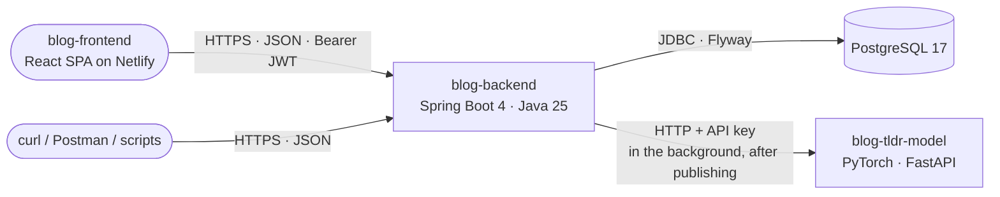

# Blog API (blog-backend)

[](https://github.com/E-L-R/blog-backend/actions/workflows/build.yml)
[](https://github.com/E-L-R/blog-backend/actions/workflows/codeql.yml)
[](LICENSE.md)

Spring Boot REST API for a technical blog. Authors write posts in Markdown, and readers browse them
by tag, search them and comment on them. Each published post gets a short **TL;DR** written by a
language model we build ourselves from scratch in PyTorch, in
[`E-L-R/blog-tldr-model`](https://github.com/E-L-R/blog-tldr-model), and call over HTTP. The web
frontend is a separate project: [`E-L-R/blog-frontend`](https://github.com/E-L-R/blog-frontend).

## Architecture



- A **REST-only JSON API** under `/api/v1` ([ADR-0002](docs/adr/0002-serve-a-rest-only-json-api.md),
  [ADR-0008](docs/adr/0008-version-the-api-in-the-path.md)), with every error as an RFC 9457 problem
  detail ([ADR-0007](docs/adr/0007-report-errors-as-rfc-9457-problem-details.md), [problem types](docs/problems.md)).
- **Stateless authentication**: short-lived JWT access tokens and rotating refresh tokens
  ([ADR-0004](docs/adr/0004-jwt-access-tokens-with-rotating-refresh-tokens.md)).
- **Code organized by feature** (`auth`, `user`, `post`, `tag`, `comment`, `tldr`), with the rules
  enforced by ArchUnit ([ADR-0003](docs/adr/0003-organize-code-by-feature.md)).
- **TL;DRs come from our own model**, behind a port and generated asynchronously, so a slow or down
  model never blocks publishing ([ADR-0005](docs/adr/0005-generate-tldrs-with-our-own-model-behind-a-port.md)).
- **PostgreSQL with Flyway migrations**, tested against the real database with Testcontainers
  ([ADR-0006](docs/adr/0006-store-data-in-postgresql-with-flyway-migrations.md)).

## Tech stack

| Area | Choice |
| --- | --- |
| Language and runtime | Java 25 (Eclipse Temurin) |
| Framework | Spring Boot 4.1 (Spring Framework 7): Web MVC, Validation, Data JPA, Actuator |
| Security | Spring Security 7, OAuth2 Resource Server (JWT, RS256) |
| Database | PostgreSQL 17, schema migrations with Flyway |
| API documentation | springdoc-openapi (OpenAPI 3, Swagger UI) |
| Tests | JUnit 6, AssertJ, MockMvc, Testcontainers, JaCoCo coverage gate |
| Build and quality | Maven (wrapper), Spotless (Palantir Java Format), GitHub Actions, CodeQL, Dependabot |

## Local development

Prerequisites: JDK 25, and Docker running (for PostgreSQL and the tests).

You can run the application locally using either Docker Compose or Testcontainers.

### Option 1: Run with Docker Compose

Spring Boot detects `compose.yaml` and starts PostgreSQL 17 on port 5432:

```bash
./mvnw spring-boot:run
```

Alternatively, start PostgreSQL in the background first:

```bash
docker compose up -d
./mvnw spring-boot:run
```

### Option 2: Run with Testcontainers (zero local DB setup)

```bash
./mvnw spring-boot:test-run
```

## Running tests

```bash
./mvnw test          # fast unit tests
./mvnw clean verify  # everything: formatting, unit + integration tests, coverage gate
```

Integration tests (`*IT`) run against a real PostgreSQL in Docker, with the same image as `compose.yaml`.

## API

Planned: interactive documentation with Swagger UI ([#14](https://github.com/E-L-R/blog-backend/issues/14)), and the conventions for versioning,
paging and sorting ([#15](https://github.com/E-L-R/blog-backend/issues/15)). Every error follows [`docs/problems.md`](docs/problems.md).

## Deployment

Planned: a container image ([#51](https://github.com/E-L-R/blog-backend/issues/51)) and a production Compose stack with TLS ([#53](https://github.com/E-L-R/blog-backend/issues/53)), deployed to a VM
with GitHub Environments ([#81](https://github.com/E-L-R/blog-backend/issues/81)).

## Documentation

Everything lives in [`docs/`](docs/README.md): architecture decision records, problem types, and
more as features land.

## Roadmap

Milestones from foundation to v1.0: [#58](https://github.com/E-L-R/blog-backend/issues/58).

## Contributing

See [CONTRIBUTING.md](CONTRIBUTING.md) for branches, commit messages, and how to run the checks.

## License

[MIT](LICENSE.md) © 2026 E-L-R
