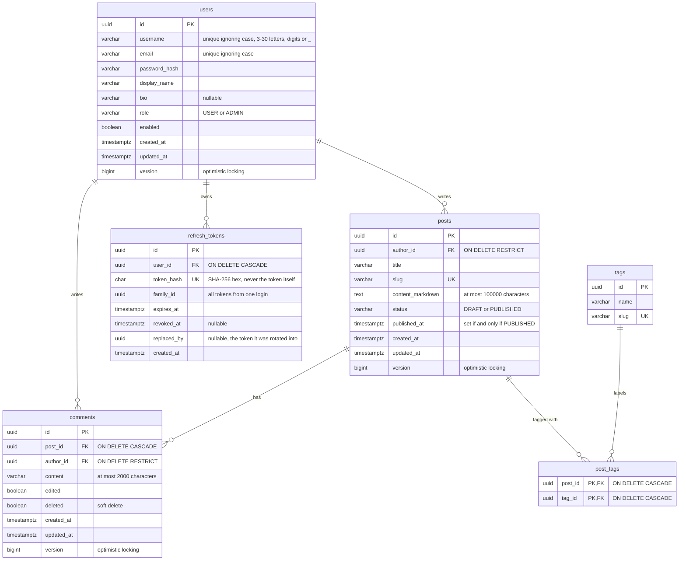

# Database schema

The schema is owned by Flyway migrations in
[`src/main/resources/db/migration`](../src/main/resources/db/migration); Hibernate only validates
against it ([ADR-0006](adr/0006-store-data-in-postgresql-with-flyway-migrations.md)). This page shows
the baseline, [`V1__init.sql`](../src/main/resources/db/migration/V1__init.sql)
([#11](https://github.com/E-L-R/blog-backend/issues/11)).

## Rules the database enforces

| Rule | How |
| --- | --- |
| "Alice" and "alice" are the same account; the same goes for emails | Unique expression indexes on `lower(username)` and `lower(email)` |
| Usernames are 3–30 letters, digits or underscores | `CHECK (username ~ '^[A-Za-z0-9_]{3,30}$')` |
| A post is published if and only if it has a publication date | `CHECK ((status = 'PUBLISHED') = (published_at IS NOT NULL))` |
| Post bodies are at most 100,000 characters | `CHECK (char_length(content_markdown) <= 100000)` |
| Roles and post states are from a fixed list | `CHECK (role IN (...))`, `CHECK (status IN (...))` |
| Slugs and token hashes are unique | `UNIQUE` constraints |
| Deleting a post deletes its comments and tag links, deleting a tag removes it from posts, and deleting a user deletes their refresh tokens | `ON DELETE CASCADE` |
| A user with posts or comments can't be deleted by accident | `ON DELETE RESTRICT` |

All primary keys are UUIDs generated by the application, and all timestamps are `TIMESTAMPTZ`.

## Indexes, and the queries they serve

| Index | Query |
| --- | --- |
| `posts_published_idx (published_at DESC) WHERE status = 'PUBLISHED'` | The latest published posts. A partial index: drafts are never listed publicly. |
| `posts_author_idx (author_id, created_at DESC)` | An author's own posts, newest first |
| `post_tags_tag_idx (tag_id)` | Posts with a tag (the primary key already covers `post_id`) |
| `comments_post_created_idx (post_id, created_at)` | A post's comments, oldest first |
| `refresh_tokens_family_idx (family_id)` | Revoking a whole token family when reuse is detected |
| `refresh_tokens_user_idx (user_id)` | Revoking all of a user's tokens (logout everywhere, password change) |

## Coming in later migrations

- `V2`: a generated full-text search column on `posts`, with its index ([#33](https://github.com/E-L-R/blog-backend/issues/33)).
- `V3`: the `post_tldrs` table, one row per post with the TL;DR's state and provenance ([#41](https://github.com/E-L-R/blog-backend/issues/41)).

Merged migrations are never edited: every change is a new `V<n>__description.sql`.
